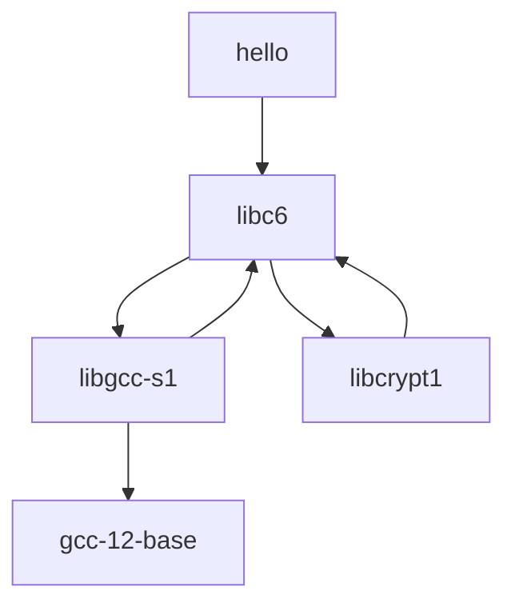
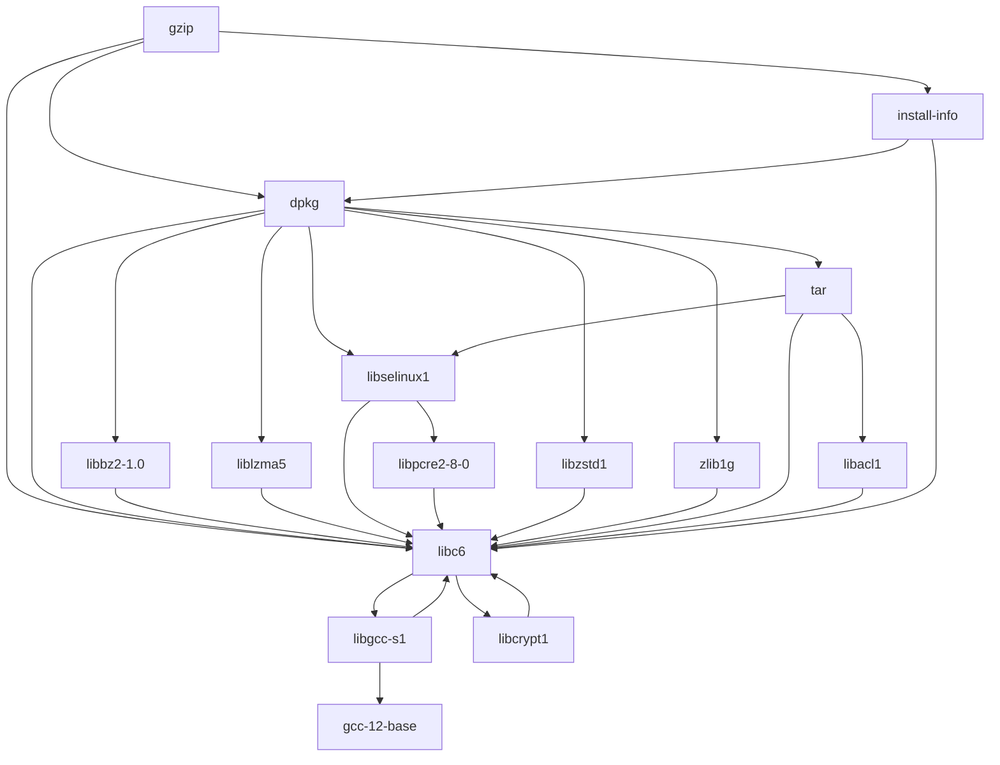
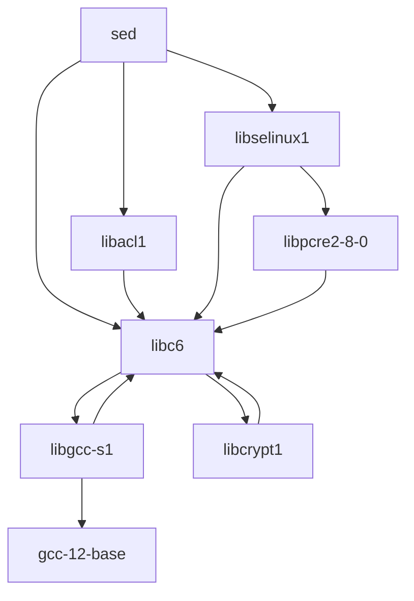

# Визуализатор зависимостей пакетов Ubuntu

Учебный CLI-инструмент для получения и визуализации зависимостей
пакетов Ubuntu.

## Требования

- Python 3.10 или новее.
- Для загрузки реального репозитория на следующих этапах нужен интернет.

Приложение использует стандартную библиотеку Python.
Менеджеры пакетов и сторонние библиотеки для получения зависимостей
не используются.

## Состояние проекта

Реализованы этапы 1–5:

- параметры командной строки и проверка конфигурации;
- получение прямых зависимостей из индекса Ubuntu;
- построение транзитивного графа итеративным DFS;
- обработка циклов и тестовые репозитории;
- поиск обратных зависимостей;
- вывод Mermaid и примеры для трёх пакетов Ubuntu.

Настроена автоматическая проверка и сравнение с apt-cache dotty.

## Запуск

Все команды выполняются из корневой папки проекта.

```powershell
$repo = "https://archive.ubuntu.com/ubuntu/dists/jammy/main/binary-amd64/Packages.gz"
.\run.bat --package hello --repository $repo --version 2.10-2ubuntu4
```

Репозиторий: Ubuntu 22.04 Jammy, компонент main, архитектура amd64.

Программа выводит граф зависимостей выбранного пакета.
Примеры результатов приведены в разделе «Этап 3. Построение графа
зависимостей».

Без скрипта Windows приложение можно запустить командой:

```powershell
python -m src.cli --package hello --repository $repo --version 2.10-2ubuntu4
```

```powershell
python -m src.cli --package bash --repository https://example.org/Packages.gz --version 1.0
```

Адрес example.org используется только для демонстрации конфигурации.
На первом этапе приложение не обращается к сети.

Результат:

```text
package=bash
repository=https://example.org/Packages.gz
test_mode=false
version=1.0
```

Запуск в Windows через скрипт:

```powershell
.\run.bat --package bash --repository https://example.org/Packages.gz --version 1.0
```

## Параметры

| Параметр | Назначение |
| --- | --- |
| `--package` | Имя анализируемого пакета |
| `--repository` | URL индекса или путь к тестовому файлу |
| `--test-mode` | Включение режима тестового репозитория |
| `--version` | Точная версия пакета |
| `--reverse` | Поиск прямых и транзитивных обратных зависимостей |
| `--format` | Формат вывода: text или mermaid; по умолчанию text |
| `--help` | Справка |

В обычном режиме используются имена пакетов Ubuntu.
В тестовом режиме имена состоят из больших латинских букв.
Параметр `--test-mode` является флагом и не принимает значения.

## Проверка ошибок

Неверное имя пакета:

```powershell
python -m src.cli --package "Bad Name" --repository https://example.org/Packages.gz --version 1.0
```

Неверный URL:

```powershell
python -m src.cli --package bash --repository invalid --version 1.0
```

Неверная версия:

```powershell
python -m src.cli --package bash --repository https://example.org/Packages.gz --version latest
```

Неверное использование флага тестового режима:

```powershell
python -m src.cli --package A --repository missing.json --version 1.0 --test-mode=false
```

Несуществующий тестовый файл:

```powershell
python -m src.cli --package A --repository missing.json --version 1.0 --test-mode
```

При ошибке выводится сообщение и возвращается код завершения 2.
Проверяется также наличие всех обязательных параметров.

Ошибки параметров возвращают код завершения 2.
Ошибки загрузки репозитория и поиска пакета возвращают код 1.

Приложение проверяет точное совпадение имени и версии пакета.
Если версия отсутствует, выводятся доступные версии.
При сетевых ошибках выводится сообщение без трассировки Python.


## Тесты

```powershell
python -m unittest discover -s tests -v
```

## Структура

- `src/` — исходный код.
- `tests/` — автоматические тесты.
- `run.bat` — скрипт запуска для Windows.
- `.gitignore` — правила исключения служебных файлов.

## Этап 2. Получение прямых зависимостей

Приложение загружает индекс Packages по HTTP или HTTPS.
Поддерживаются обычный текст и сжатие gzip и xz.
Формат записей разбирается собственным кодом.

Используются поля Pre-Depends и Depends.
Альтернативы и ограничения версий сохраняются в исходном виде.
Рекомендации Recommends и предложения Suggests не включаются.

Для hello версии 2.10-2ubuntu4 получена зависимость:

```text
libc6 (>= 2.34)
```

Проверены следующие ошибки:

| Случай | Результат |
| --- | --- |
| Неизвестный пакет | Сообщение Package not found |
| Отсутствующая версия | Сообщение со списком доступных версий |
| Отсутствующий индекс | Сообщение HTTP Error 404 |

URL должен вести непосредственно на индекс Packages,
Packages.gz или Packages.xz, а не на главную страницу репозитория.

На этом этапе выводятся только прямые зависимости.
Транзитивный граф будет построен на этапе 3.

## Этап 3. Построение графа зависимостей

Граф строится алгоритмом DFS без рекурсии.
Для обхода используется стек, для хранения посещённых вершин —
словарь построенного графа.

Каждый достижимый пакет раскрывается один раз.
Циклические связи сохраняются, повторный обход вершин не выполняется.
Недостижимые из выбранного пакета вершины в результат не включаются.

### Формат тестового репозитория

Тестовый репозиторий хранится в JSON:

```json
{
  "version": "1.0",
  "packages": {
    "A": ["B"],
    "B": []
  }
}
```

Поле version задаёт общую версию всех пакетов.
Имена состоят из больших латинских букв.
Каждая зависимость должна присутствовать в словаре packages.

### Демонстрационные случаи

Цепочка A → B → C:

```powershell
.\run.bat --package A --repository tests/fixtures/chain.json --version 1.0 --test-mode
```

Ветвление с общей зависимостью D:

```powershell
.\run.bat --package A --repository tests/fixtures/branch.json --version 1.0 --test-mode
```

Результат обхода ветвления:

```text
A -> B, C
B -> D
D -> (none)
C -> D
```

Цикл A → B → C → A:

```powershell
.\run.bat --package A --repository tests/fixtures/cycle.json --version 1.0 --test-mode
```

Результат обхода цикла:

```text
A -> B
B -> C
C -> A
```

Пакет без зависимостей:

```powershell
.\run.bat --package A --repository tests/fixtures/isolated.json --version 1.0 --test-mode
```

Самозависимость B → B:

```powershell
.\run.bat --package B --repository tests/fixtures/isolated.json --version 1.0 --test-mode
```

Автоматические тесты также проверяют цепочку из 2001 вершины.

### Особенности графа Ubuntu

Корневой пакет выбирается по точному совпадению имени и версии.
Для остальных пакетов используется единственная запись
в выбранном индексе. Несколько записей считаются неоднозначностью
и приводят к сообщению об ошибке.

Строится граф объявленных обязательных зависимостей:
учитываются Pre-Depends, Depends и все альтернативы.

Ограничения версий транзитивных зависимостей не разрешаются.
Виртуальные пакеты не заменяются их поставщиками.
Отсутствующие в индексе пакеты сохраняются как вершины без раскрытия
и перечисляются в Unresolved packages.

Таким образом, результат представляет структуру зависимостей,
а не план установки, вычисленный apt.

## Этап 4. Обратные зависимости

Режим --reverse находит пакеты, которые зависят от выбранного пакета
напрямую или транзитивно.

Сначала строится граф всего выбранного репозитория.
Затем направления связей меняются на противоположные,
и выполняется итеративный DFS из этапа 3.

В обратном графе запись C -> B означает, что B зависит от C.
Корневой пакет сохраняется в выводе как начальная вершина обхода.

### Цепочка

```powershell
.\run.bat --package C --repository tests/fixtures/chain.json --version 1.0 --test-mode --reverse
```

Результат:

```text
package=C
version=1.0
Reverse dependency graph:
  C -> B
  B -> A
  A -> (none)
```

Прямая обратная зависимость C — пакет B.
Транзитивная обратная зависимость — пакет A.

### Ветвление

```powershell
.\run.bat --package D --repository tests/fixtures/branch.json --version 1.0 --test-mode --reverse
```

Результат:

```text
package=D
version=1.0
Reverse dependency graph:
  D -> B, C
  B -> A
  A -> (none)
  C -> A
```

Пакеты B и C напрямую зависят от D.
Пакет A зависит от D транзитивно и раскрывается один раз.

### Цикл

```powershell
.\run.bat --package A --repository tests/fixtures/cycle.json --version 1.0 --test-mode --reverse
```

Результат:

```text
package=A
version=1.0
Reverse dependency graph:
  A -> C
  C -> B
  B -> A
```

Циклические связи сохраняются, обход завершается.

### Отсутствие обратных зависимостей

```powershell
.\run.bat --package A --repository tests/fixtures/chain.json --version 1.0 --test-mode --reverse
```

Результат содержит только начальную вершину A без исходящих связей.

Для Ubuntu поиск ограничен выбранным индексом репозитория.
Сохраняются ограничения обработки версий и виртуальных пакетов,
описанные в разделе этапа 3.

## Этап 5. Визуализация Mermaid

Приложение формирует текстовое описание графа на языке Mermaid.

```powershell
.\run.bat --package A --repository tests/fixtures/branch.json --version 1.0 --test-mode --format mermaid
```

Поддерживается также сочетание --reverse --format mermaid.

### Примеры для пакетов Ubuntu

Источник: Ubuntu 22.04 Jammy, main, amd64.

- [hello, версия 2.10-2ubuntu4](examples/hello.md)
- [gzip, версия 1.10-4ubuntu4](examples/gzip.md)
- [sed, версия 4.8-1ubuntu2](examples/sed.md)

Каждый файл содержит диаграмму, сформированную приложением.

#### hello, версия 2.10-2ubuntu4



#### gzip, версия 1.10-4ubuntu4



#### sed, версия 4.8-1ubuntu2



### Сравнение со штатным инструментом

Проверочный скрипт Проверочный скрипт scripts/compare_apt.py сравнивает связи нашего графа сравнивает связи нашего графа
с выводом apt-cache dotty для того же источника Ubuntu.

Команды apt используются исключительно для независимого сравнения.
Приложение из src не использует их для получения зависимостей.

Проверка выполняется через GitHub Actions.
Отчёт доступен в сводке запуска Compare dependency graphs.
Вывод штатного инструмента сохраняется в артефакте apt-comparison.

Сравниваются связи между именами пакетов.
Оформление DOT, ограничения версий и формы вершин не сравниваются.

### Результаты сравнения

Сравнение выполнено для Ubuntu 22.04 Jammy, main, amd64.

| Пакет | Версия | Наш граф | apt-cache dotty |
| --- | --- | --- | --- |
| hello | 2.10-2ubuntu4 | 6 | 26 |
| gzip | 1.10-4ubuntu4 | 28 | 55 |
| sed | 4.8-1ubuntu2 | 12 | 30 |

Числа обозначают количество уникальных направленных связей.
Для всех трёх пакетов связи только в нашем графе отсутствуют.
Нераскрытых пакетов в наших графах нет.

apt-cache dotty отображает не только обязательные зависимости,
но и другие отношения, включая конфликты и несовместимости.
Наше приложение учитывает только Depends и Pre-Depends.

Проверочный скрипт сравнивает стрелки между именами пакетов
без учёта типа отношения и оформления DOT.
Поэтому дополнительные связи apt не означают пропущенные
обязательные зависимости.

Все связи приложения присутствуют в графе apt.
Полная эквивалентность типов отношений и разрешения версий
этой проверкой не устанавливается.